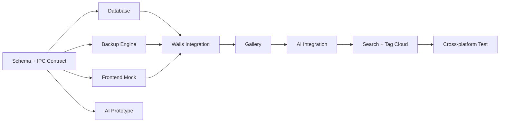

# Milestones

กลับไปที่ [[00-Project Home]]

## Milestone 0 — Team Contract

- [x] ยืนยัน User Flow
- [x] ยืนยัน Database 4 ตาราง
- [x] ยืนยันชนิดรูปที่รองรับ
- [x] ยืนยัน [[04-Wails-Nuxt-IPC/00-IPC Contract|IPC Contract]]
- [ ] เลือก AI Provider
- [ ] เตรียมรูปทดสอบชุดเดียวกัน

## Milestone 1 — Parallel Foundation

- สมาชิก 1: Models, SQLite และ GORM
- สมาชิก 2: Scan/Move Engine ด้วย Temporary Directory
- สมาชิก 3: UI ด้วย Mock Data
- สมาชิก 4: AI Prototype และ Search Query Design

## Milestone 2 — Backup MVP

- [x] Select Source/Destination
- [x] Scan และเลือกภาพ
- [x] Move Selected/All
- [x] Duplicate Protection
- [x] Database Records
- [x] Progress และเวลา
- [ ] Integrity Check

> [!note]
> ส่วนที่พัฒนาแล้วผ่าน `go test ./...` และ Nuxt Production Build แต่ยังต้องทดสอบ End-to-End บน Windows และ Flash Drive จริง

> [!important]
> Backup MVP ต้องเสร็จก่อนเพิ่ม AI ขั้นสูง เพราะเป็นฐานข้อมูลและไฟล์สำหรับทุก Feature หลังจากนี้

## Milestone 3 — Gallery และ AI

- [x] หน้า Gallery แสดงรายการจาก Database ตาม Destination พร้อม Description และสถานะ
- [x] สร้าง GalleryPhoto DTO, Service, Controller และ Wails Bindings สำหรับรายการ
- [x] เพิ่ม Repository ค้นรูปตาม ID + Destination และ Service โหลด Preview
- [ ] เปิด Preview ผ่าน Controller/Bindings และแสดงภาพจริงใน Gallery
- [ ] ตรวจไฟล์จริงบน Disk เพื่ออัปเดต active/missing
- [ ] เข้าคิว AI อัตโนมัติหลังแต่ละรูปย้ายและบันทึก DB สำเร็จ
- [ ] AI สร้างและบันทึก Description จากไฟล์ใน Destination
- [ ] Analysis Status
- [ ] Retry

## Milestone 4 — Search

- [ ] Description Search
- [ ] ส่วนเสริม: Tag Search
- [ ] ส่วนเสริม: Combined Search
- [ ] ส่วนเสริม: Tag Cloud

MVP ใช้การค้นข้อความใน SQLite ไม่ใช้ Vector Search และไม่นำเข้ารูปเดิมจาก Destination

## Milestone 5 — Cross-platform และ Demo

- [ ] Windows Test
- [ ] macOS Test
- [ ] Flash Drive Test
- [ ] Production Build
- [ ] Security Check
- [ ] Demo Dataset
- [ ] Demo Rehearsal

## Dependency Map

