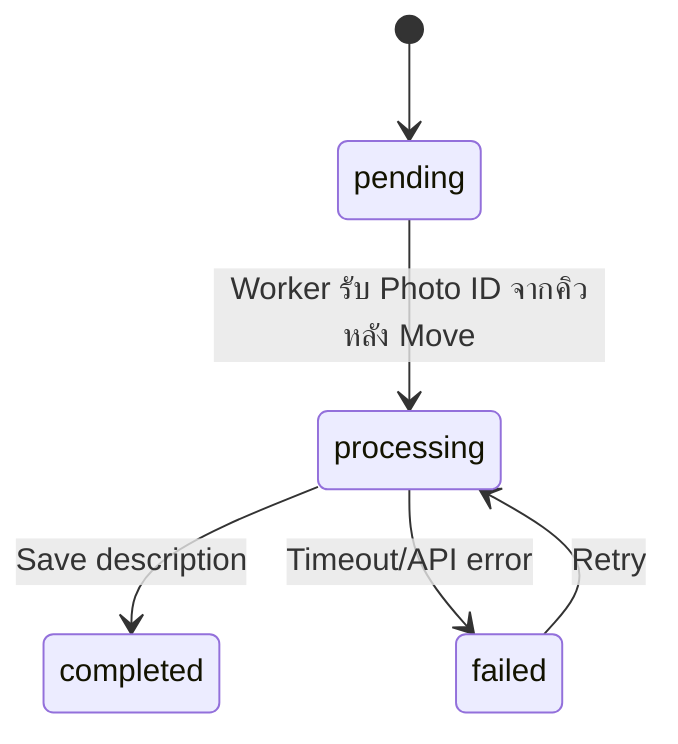

# AI and Search

กลับไปที่ [[00-Backend Architecture]]

## Analysis Flow



## Flow ที่ตกลง (2026-10-16)

1. รูปแต่ละรูปย้ายและ Verify สำเร็จ
2. บันทึก Photo และรับ ID โดย `analysis_status = pending`
3. ส่ง Photo ID เข้าคิว AI แยกจาก Worker ย้ายรูปทันที ไม่รอทั้งชุด
4. AI Worker โหลด record และอ่าน `dest + filename` ตั้งสถานะเป็น `processing`
5. เรียก AI และ Validate ผล แล้วบันทึก Description พร้อม `completed` ใน Transaction เดียว
6. ส่ง `analysis:progress` ให้ Gallery อัปเดตตาม Photo ID

AI ล้มเหลวให้ตั้ง `failed` และ Retry ได้ โดยผล Move ยังสำเร็จเหมือนเดิม

## Rules

- อ่านรูปจาก Destination เท่านั้น
- เฉพาะรูปที่ย้ายผ่านโปรแกรมและบันทึก DB สำเร็จเท่านั้นที่เข้าคิวครั้งแรก
- ไม่สแกนนำเข้ารูปเดิมจาก Destination และไม่ส่งรูป skipped/failed เข้าคิวใหม่
- จำกัด AI Worker แยกจาก Move Worker; ป้องกัน Photo ID เดียวกันถูกวิเคราะห์พร้อมกัน
- ตอนเปิดแอปให้ตรวจ record pending/processing ที่ค้างและไฟล์ที่ยังอยู่ เพื่อกู้คืนคิวโดยไม่ต้องนำเข้าไฟล์จาก Disk
- AI ไม่ต้องเข้าถึง Source
- AI ล้มเหลวต้องไม่ลบหรือย้อน Move
- เก็บผลใน Database เพื่อไม่วิเคราะห์ซ้ำ
- API response ต้องถูก Validate ก่อนบันทึก
- จำกัด Timeout และจำนวน Retry
- API Key ห้ามอยู่ใน Source Code หรือ Git

## Expected Result

```text
Description: แมวสีส้มนั่งอยู่บนโซฟา
```

Description เป็นผลหลักใน MVP ไม่จำเป็นต้องเก็บ Confidence; Tags/Tag Cloud เป็นส่วนเสริม และไม่ใช้ Vector/Embedding

## Search

### Description Search

- รับข้อความจากผู้ใช้
- ค้นแบบบางส่วน
- ไม่สนตัวพิมพ์เล็ก/ใหญ่สำหรับภาษาอังกฤษ
- Filter ตาม Destination และ Status

### Tag Search

ส่วนเสริมหลัง Description Search ใช้งานได้

- Join `photos`, `photo_tags`, `tags`
- เลือกหนึ่งหรือหลาย Tags
- ค้นเฉพาะ Photo สถานะ `active`

### Tag Cloud

ส่วนเสริม หากใช้ Tags จึงต้องมี Tag Cloud ตามโจทย์

- Group ตาม Tag
- Count จำนวน Photos
- ขนาด Tag ใน UI อิงจำนวนที่พบ
- Filter ตาม Destination ปัจจุบัน

## Failure Cases

- ไม่มี Internet
- API Key ไม่ถูกต้อง
- Rate Limit
- Unsupported Image
- Response ไม่เป็นรูปแบบที่กำหนด
- Database Save ล้มเหลว

เมื่อเกิดข้อผิดพลาดให้พยายามบันทึก `failed` และ Error ที่เหมาะสมเพื่อ Retry หาก Database ใช้งานไม่ได้ต้อง Log/รายงาน และกู้คืนสถานะเมื่อเชื่อมต่อได้อีกครั้ง
